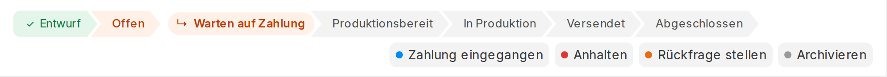

# Workflow Stepper

Shows the active [Frappe workflow](https://docs.frappe.io/framework/user/en/desk/workflows) of a
document as a **step bar above the form tabs** — the way Marello and OroCommerce visualise their
order workflows:

- passed steps ticked in green, the current step highlighted in the colour of its Workflow State,
- side states (on hold, waiting for payment, returned, …) shown as a branch off the main path,
- the transitions the current user may apply right now as buttons next to the bar (same code path
  as the *Actions* menu, which stays untouched),
- light and dark mode, any doctype, no changes to Frappe core.



Stock Frappe shows only the current state as a pill in the form header and the allowed transitions
in the *Actions* dropdown. This app adds the overview of where the document is on its way.

## How it works

The bar is rendered entirely from data Frappe already ships to the browser with the doctype meta:
the active `Workflow` document (states in row order, transitions), the `Workflow State` colours, and
`frappe.model.workflow.get_transitions` for the buttons. A transition button calls the form's own
workflow handler, so `before_workflow_action` / `after_workflow_action` scripts and the
*Enable Action Confirmation* setting keep working.

## Configuration

Installing the app adds three fields to the **Workflow** document:

| Field | Where | Meaning |
|---|---|---|
| *Show Workflow Bar on Form* | Workflow | Master switch per workflow (default on). |
| *Show Actions in Workflow Bar* | Workflow | Render the allowed transitions as buttons (default on). |
| *Step in Workflow Bar* | Workflow → States rows | Tick the states that form the **main path**, in row order. |

States that are not ticked are treated as side states: when a document is in one of them, the bar
shows it as a branch hanging off the path state it is reached from (or returns to). If nothing is
ticked, every state except cancelled ones is shown as a step.

Example — an order workflow with the main path `Draft → Open → Ready → In Production → Shipped →
Completed` and side states `Waiting for Payment`, `On Hold`, `Returned`, `Cancelled`:

```
✓ Draft › Open › ↳ Waiting for Payment › Ready › In Production › Shipped › Completed   [Payment received] [Hold]
```

## Installation

```bash
cd $PATH_TO_YOUR_BENCH
bench get-app https://github.com/<owner>/workflow_stepper --branch main
bench --site <site> install-app workflow_stepper
```

Tested with Frappe v16 (the form tabs layout of v15 and v16; on v14 the bar is prepended to the
form page instead).

## Compatibility notes

- The bar mounts above `.form-tabs-list`, so it is visible on every tab. It deliberately does not
  use `frm.dashboard.add_section`, which lands inside the *Connections* tab in v15/v16.
- A form that is dirty (unsaved changes) shows the bar without buttons, mirroring Frappe hiding the
  *Actions* menu in that case.
- Custom fields are re-asserted on every `bench migrate` and removed on uninstall.

## License

MIT
